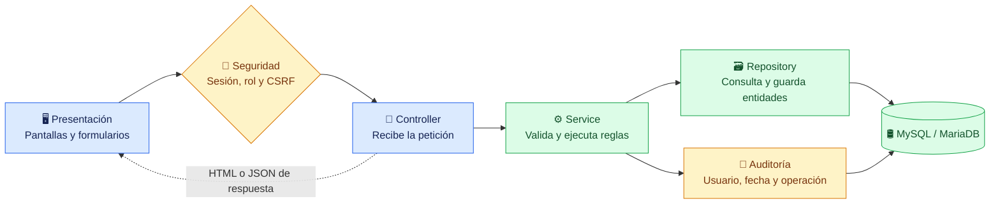
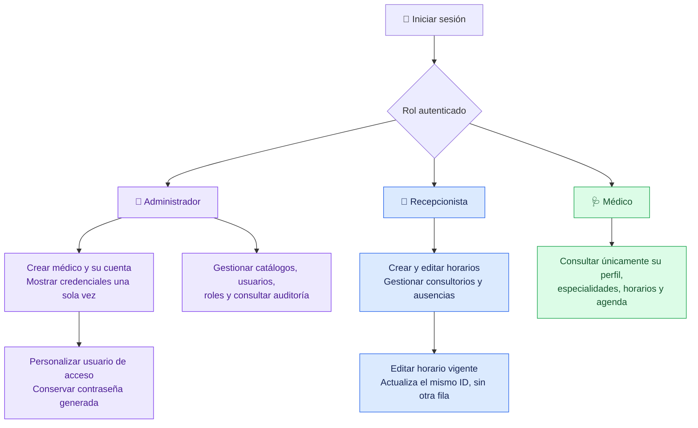

# 🏥 Sistema de Médicos y Especialidades

Aplicación web para gestionar médicos, especialidades, consultorios y horarios de atención. Incluye agenda semanal, ausencias, cuentas de usuario y auditoría.

**Tecnologías:** Java 21 · Spring Boot · Spring Security · Hibernate/JPA · Thymeleaf · JavaScript · Bootstrap · MySQL/MariaDB.

## 🧩 Capas y flujo de una operación



| Capa / ubicación | Función en el proyecto |
|---|---|
| **Presentación** — `resources/templates` y `resources/static` | Thymeleaf construye las páginas; JavaScript consume las API y actualiza tablas y formularios; Bootstrap/CSS define la apariencia. |
| **Controller** | Expone rutas web y `/api/**`. `HomeController` carga vistas; los controladores REST reciben datos y devuelven resultados HTTP. |
| **Service** | Aplica reglas: fechas, cruces de horarios, especialidades asignadas, unicidad y permisos sobre datos propios. Coordina transacciones y auditoría. |
| **Repository** | Usa Spring Data JPA para buscar, guardar y eliminar registros; incluye bloqueos para operaciones concurrentes. |
| **Model** | Representa tablas y relaciones mediante entidades JPA: `Medico`, `HorarioAtencion`, `Consultorio`, `Usuario`, `Rol`, entre otras. |
| **config** | Configura autenticación, autorización, sesiones e inicialización. `SecurityConfig` protege rutas y `SessionRevocation` revoca sesiones cuando corresponde. |

**Ejemplo:** Recepción envía un formulario → se comprueban sesión y permisos → el servicio valida fechas y cruces → JPA actualiza el horario → se registra auditoría → la pantalla muestra el resultado.

## 🚦 Funcionamiento por rol



La agenda combina franjas semanales y ausencias. Una fecha final anterior a hoy muestra **«Vigencia Vencida»**, usando la zona `America/Lima`; esos registros muestran únicamente el icono de eliminar. La fecha final es inclusiva.

## ✅ Correspondencia con la evaluación 2

Resumen basado en los puntos documentados en [GUIA_TRABAJO_EQUIPO.md](GUIA_TRABAJO_EQUIPO.md) y [docs/ENTREGA.md](docs/ENTREGA.md).

| Punto | Cómo lo implementamos | Evidencia en `src/test/java/...` |
|---|---|---|
| **1. Relaciones Hibernate/JPA** | `@ManyToOne`, `@OneToMany` y `@OneToOne`. Médico → horarios; consultorio → especialidad; médico ↔ especialidad mediante tabla puente; usuario ↔ médico. | `RelacionesJpaTests` |
| **2. Auditoría** | Registra usuario, fecha, INSERT/UPDATE/DELETE, entidad e ID. Participa en la transacción de la operación. | `AuditoriaCrudTests` |
| **3. Usuarios y roles: backend** | CRUD y estados, contraseñas BCrypt, contraseña excluida del JSON y protección del último administrador activo. | `SeguridadUsuariosRolesTests`, `CuentasMedicosTests` |
| **4. Usuarios y roles: frontend** | Formularios y tablas conectados a API; edición, estados, validaciones y mensajes. Usuarios muestra solo editar en Acciones. | `ModulosEntregaTests`, `scripts/test-nombres-usuarios.js` |
| **5. Acceso por rol** | Rutas protegidas, login/logout y CSRF. El médico consulta solo datos vinculados a su cuenta mediante `AlcanceMedicoService`. | `PanelMedicoTests`, `SeguridadUsuariosRolesTests` |

**Reglas adicionales comprobadas:** edición sin duplicar horarios, rechazo de cruces, eliminación de periodos vencidos y cambio de usuario conservando la contraseña generada.

## ▶️ Ejecución y comprobación

Con JDK 21 y la base configurada según [docs/CONEXION_LOCAL.md](docs/CONEXION_LOCAL.md):

```powershell
.\mvnw.cmd spring-boot:run   # Abrir http://localhost:8080/login
.\mvnw.cmd test             # Pruebas automatizadas con perfil de pruebas
```

Los reportes de cada ejecución quedan en `target/surefire-reports`. Las evidencias históricas de H2 y MariaDB están en `docs/evidencias/`; corresponden a la revisión en que fueron generadas.

> Los diagramas se visualizan en GitHub y en visores Markdown compatibles con Mermaid.
